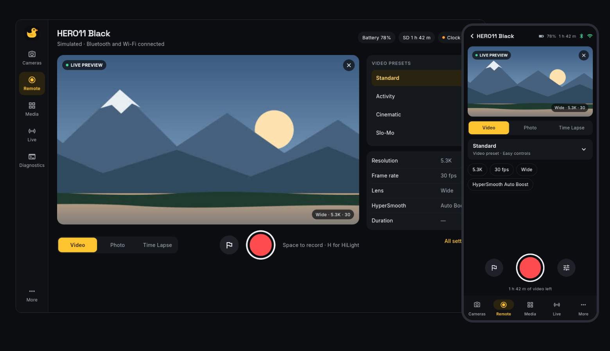
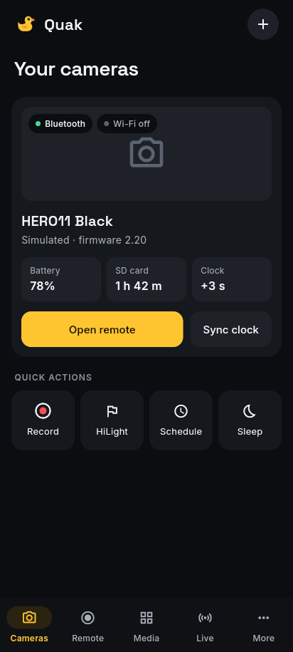
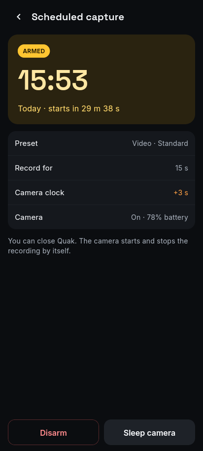
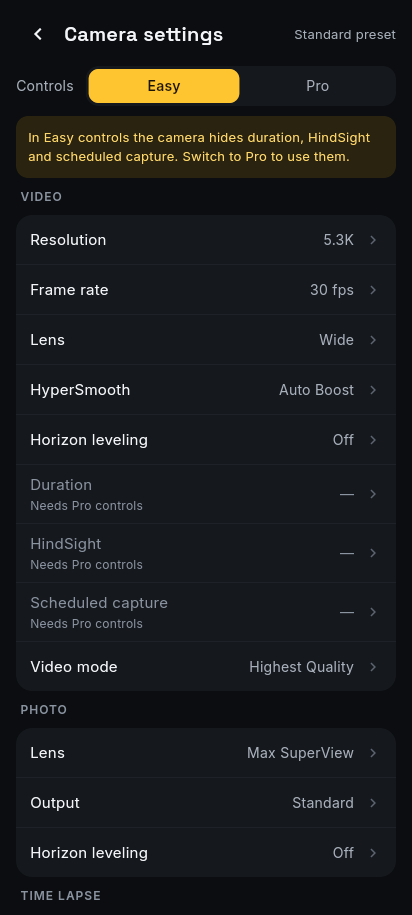
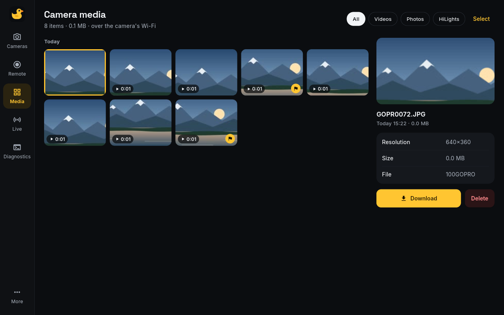
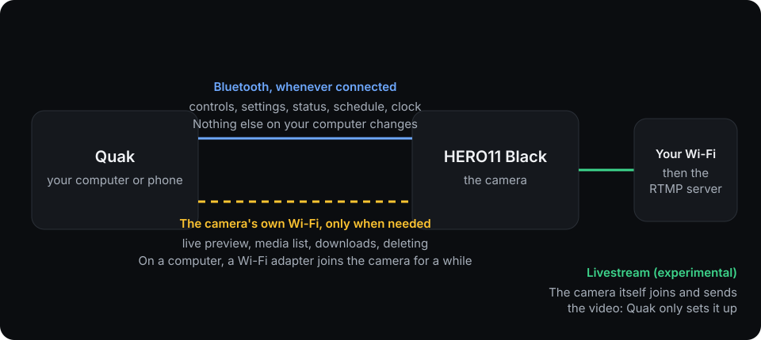

<p align="center"></p>

<h1 align="center">Quak</h1>

<p align="center">An open-source remote for the GoPro HERO11 Black: a command-line tool and an app for desktop and Android.</p>

<p align="center"><b>English</b> · <a href="https://github.com/ADCDS/quak/blob/main/docs/i18n/pt-BR/README.md">Português (Brasil)</a> · <a href="https://github.com/ADCDS/quak/blob/main/docs/i18n/es/README.md">Español</a> · <a href="https://github.com/ADCDS/quak/blob/main/docs/i18n/fr/README.md">Français</a> · <a href="https://github.com/ADCDS/quak/blob/main/docs/i18n/de/README.md">Deutsch</a> · <a href="https://github.com/ADCDS/quak/blob/main/docs/i18n/ru/README.md">Русский</a> · <a href="https://github.com/ADCDS/quak/blob/main/docs/i18n/zh-CN/README.md">简体中文</a> · <a href="https://github.com/ADCDS/quak/blob/main/docs/i18n/ja/README.md">日本語</a></p>

<p align="center"></p>

Quak talks to the camera over Bluetooth and the camera's own Wi-Fi, using GoPro's public
[Open GoPro API](https://gopro.github.io/OpenGoPro/). No account and no cloud.

> **Status: early, and tested on one camera.** It's built around one HERO11 Black (firmware 2.20). Other models get a
> warning and may not work. See [what has been tested](#what-has-been-tested) before you rely on it.

## Try it without a camera

Quak includes a simulated camera that speaks the real protocol, so you can try everything first. You need Python 3.11 or
newer.

```bash
pipx install 'quak-camera[gui]'               # or pip, in a virtual environment

quak --sim info                               # the command line
quak --sim schedule arm +2m --duration 15s
quak-gui --sim                                # the app (the first launch downloads about 45 MB)
```

Or download a ready-made app for Linux, Windows or Android from [Releases](https://github.com/ADCDS/quak/releases). The
[install guide](https://github.com/ADCDS/quak/blob/main/docs/install.md) has the details for each system.

<p align="center"></p>

## What it does

- **Remote control:** record, take photos, tag HiLights, change presets and every HERO11 setting.
- **Scheduled capture:** arm the camera for a time and a length, with its clock synced first. It starts and stops by itself,
  even if you switch it off after arming.
- **Live preview** over the camera's Wi-Fi. The camera can't stream while it records, so preview pauses until you stop.
- **Media:** browse the card, download clips, and delete them, with a confirmation that names the file.
- **In your language:** the app follows your system's language, or you can choose in **More**: English, Português (Brasil),
  Español, Français, Deutsch, Русский, 简体中文 or 日本語. The command line stays in English.
- **Livestream** to an RTMP server such as YouTube or Twitch. This is **experimental**: see [known issues](https://github.com/ADCDS/quak/blob/main/docs/troubleshooting.md#known-issues).
- **Camera Lab** (advanced, Linux, experimental): on a HERO11 that already has its own SSH login, log in over SSH, switch the USB-C port to USB host mode, and inspect devices and storage. Quak installs nothing on the camera. See the [Camera Lab guide](https://github.com/ADCDS/quak/blob/main/docs/camera-lab.md).

<p align="center">
  
  
  
</p>

<p align="center"></p>

Screenshots come from the simulated camera, with a drawn scene instead of real footage.

## Use it with your camera

Install it as above, plus what [the install guide](https://github.com/ADCDS/quak/blob/main/docs/install.md) lists for your system. Then pair once. On the camera, open
**Preferences > Connections > Connect Device > GoPro Quik App**, and leave that screen open while you run:

```bash
quak pair          # finds the camera on its pairing screen and remembers it
quak info
quak record --seconds 5
quak schedule arm +2m --duration 15s
quak media list
```

`quak --help` lists every command. In the app, use **Add camera**, which walks you through the same steps.

**Android:** download the APK from [Releases](https://github.com/ADCDS/quak/releases). It needs Android 10 or newer.

Before you use it for real, read [what Quak changes on your computer and camera](https://github.com/ADCDS/quak/blob/main/docs/safety.md). In short:

- On a computer, viewing media or the preview moves a Wi-Fi adapter onto the camera's network for a while. Quak avoids the
  adapter you're online through, and asks first if it's the only one.
- A scheduled capture changes the camera's Duration setting and leaves it changed, which also limits recordings you start
  by hand. Quak tells you when this happens.

<p align="center"></p>

## What has been tested

Tested on one real HERO11 Black, with the end-to-end suites on Linux and by hand on one Android phone:

| Feature | Linux | Android | Windows |
|---|---|---|---|
| Pairing and reconnecting | Tested | Tested | Not tested |
| Status, clock sync | Tested | Tested | Not tested |
| Recording | Tested | Tested | Not tested |
| HiLights, presets, settings | Tested | Not tested | Not tested |
| Scheduled capture | Tested | Not tested | Not tested |
| Live preview | Tested | Tested | Not tested |
| Media: list, download, delete | Tested | Tested | Not tested |
| Livestream | Experimental | Not tested | Not tested |

**Windows is experimental.** The Windows build compiles and its unit tests pass, but it has never been launched or used with a
camera. Livestream worked end to end, then stopped working on the test camera for a reason that isn't known yet.
[`docs/testing.md`](https://github.com/ADCDS/quak/blob/main/docs/testing.md) has the details.

## Documentation

- [Install guide](https://github.com/ADCDS/quak/blob/main/docs/install.md): Linux, Windows and Android, and building the packages
- [Safety](https://github.com/ADCDS/quak/blob/main/docs/safety.md): what Quak changes and stores, what it can delete, and how to recover
- [Troubleshooting](https://github.com/ADCDS/quak/blob/main/docs/troubleshooting.md): common problems and known issues
- [Camera Lab](https://github.com/ADCDS/quak/blob/main/docs/camera-lab.md): advanced, Linux-only SSH access, USB host mode, the bundled toolkit, storage and system panels
- [Architecture](https://github.com/ADCDS/quak/blob/main/docs/architecture.md): how the code is organised
- [Testing](https://github.com/ADCDS/quak/blob/main/docs/testing.md): the test suites and hardware results
- [Protocol notes](https://github.com/ADCDS/quak/blob/main/docs/protocol.md): what we learned about the camera, beyond the official docs
- [Contributing](https://github.com/ADCDS/quak/blob/main/CONTRIBUTING.md)

## How it was built

Quak was built with heavy AI assistance. Claude wrote most of the code, tests, documentation and the logo, and ran the test
suites on a real camera, directed by a person who also tried it on the camera and phone. The hardware claims above come from
those tests, and from nothing else.

## Licence and disclaimer

MIT: see [LICENSE](https://github.com/ADCDS/quak/blob/main/LICENSE). The packaged apps include other software under its own licences, including LGPL libraries: see
[THIRD_PARTY_NOTICES.md](https://github.com/ADCDS/quak/blob/main/THIRD_PARTY_NOTICES.md).

Quak is an independent project, not affiliated with, endorsed by or sponsored by GoPro, Inc. GoPro, HERO and Quik are
trademarks of GoPro, Inc. See [NOTICE](https://github.com/ADCDS/quak/blob/main/NOTICE).
